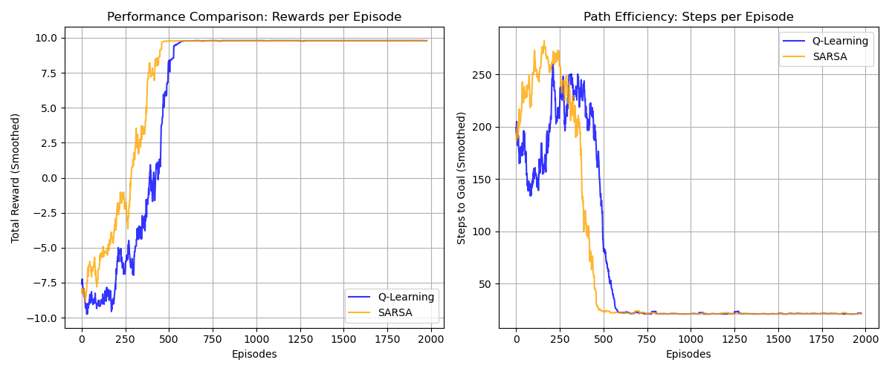
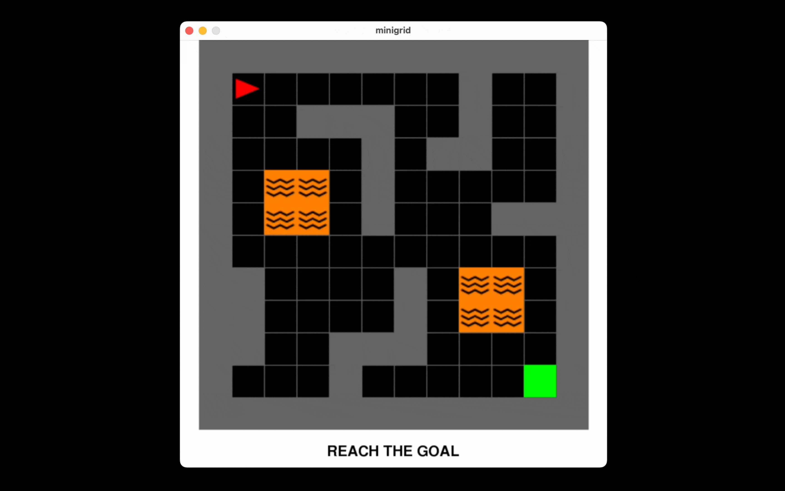
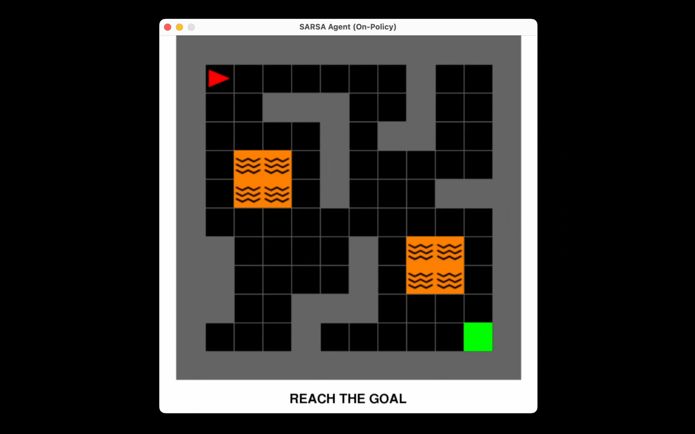

# Grid-World Reinforcement Learning: Q-Learning vs. SARSA

This project was created for my graduate-level university course: **CAP 6629 - Reinforcement Learning**. It is a comprehensive reinforcement learning project implementing and evaluating **Q-Learning (off-policy)** and **SARSA (on-policy)** algorithms in a custom 12 x 12 MiniGrid environment featuring internal walls and hazardous lava traps.

## Project Overview

This project explores how model-free tabular reinforcement learning algorithms independently discover optimal navigation policies without prior map knowledge. An agent spawns at coordinates (1, 1) and must navigate through an organically designed maze containing impassable walls (`Wall()`) and lethal lava hazards (`Lava()`) to reach the goal at (10, 10).

## Key Features

* **Custom Environment:** A specialized 12 x 12 grid-world built using Python, `Gymnasium`, and `MiniGrid`.
* **Dual Algorithm Implementation:** Implements both **Q-Learning** (off-policy temporal difference learning) and **SARSA** (on-policy temporal difference learning).
* **Automated Evaluation:** Generates performance comparison graphs tracking **Reward per Episode** and **Path Efficiency (Steps per Episode)** across 2,000 training episodes.
* **Live Visual Demos:** Features side-by-side Pygame-rendered visual simulations with custom window titles (`Q-Learning Agent (Off-Policy)` and `SARSA Agent (On-Policy)`).

---

## Performance Graphs & Results

The automated training script evaluates both agents over 2,000 episodes (alpha = 0.1, gamma = 0.99). The resulting comparison curves demonstrate successful convergence from random exploration to optimal pathing:



* **Reward Convergence:** Both agents successfully transition from negative/zero exploration rewards to a stable, optimal reward plateau.
* **Step Efficiency:** Path lengths drop sharply from the 300-step maximum timeout down to the optimal shortest path of approximately **20 to 25 steps**.

---

## Live Visual Demonstrations

Once training finishes, the script sequentially launches two interactive Pygame visual simulations to demonstrate the learned policies in action:

1. **Q-Learning Agent (Off-Policy):** 
   * *Window Title:* `Q-Learning Agent (Off-Policy)`
   * *Behavior:* Optimizes aggressively for the shortest path toward the goal.
2. **SARSA Agent (On-Policy):** 
   * *Window Title:* `SARSA Agent (On-Policy)`
   * *Behavior:* Demonstrates cautious, risk-averse navigation near hazard boundaries.

### Q-Learning Agent (Off-Policy)


### SARSA Agent (On-Policy)


---

## Installation & Prerequisites

Make sure you have Python installed along with the required dependencies:

```bash
pip install gymnasium minigrid numpy matplotlib pygame
```

## How to Run

Clone the repository and run the main script to train the agents, generate the evaluation graphs, and launch the live visual demos:

```bash
git clone https://github.com/meghane/grid-world-searching-problem.git
cd grid-world-searching-problem
python main.py
```

## Project Structure

```text
├── main.py                    # Environment, training loops, evaluation, and live demos
├── rl_comparison_results.png  # Training performance comparison graphs
└── README.md                  # Project documentation
```

## References

* Sutton, R. S., & Barto, A. G. (2018). *Reinforcement Learning: An Introduction*. MIT Press.
* [Gymnasium Documentation](https://gymnasium.farama.org/)
* [MiniGrid Documentation](https://github.com/Farama-Foundation/Minigrid)
